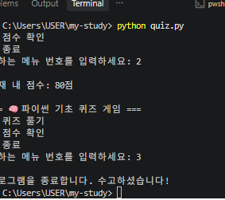
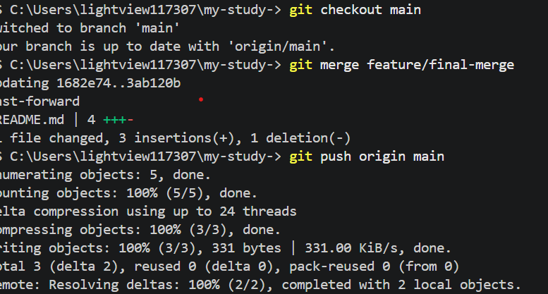

# 🐍 Mission 02. 컴퓨터에게 명령 내리는 말(파이썬) 처음 배우기

---

## 1. 📌 과제 개요

### 학습 목표
- 파이썬 기본 문법과 동작 원리 이해
- 변수, 조건문, 반복문, 함수 활용
- 클래스와 객체지향 프로그래밍 이해
- 파이썬 퀴즈 프로그램 제작
- JSON 데이터 저장 및 관리 원리 이해
- Git과 GitHub를 활용한 버전 관리

파이썬 기초 개념을 직접 퀴즈 프로그램으로 만들고 실행하면서 재미있게 복습하기 위해 주제를 선정하였습니다.

---

## 2. 🛠 개발 환경

| 구분 | 사용 도구 |
|---|---|
| 언어 | Python 3.x |
| 편집기 | Visual Studio Code |
| 버전 관리 | Git |
| 원격 저장소 | GitHub |
| 데이터 저장 설계 | JSON |
| 학습 보조 | 생성형 AI |

---

## 3. 📂 프로젝트 파일 구조

```text
my-study-/
├── Task3-MAC/    # 별도의 3과제
├── images/       # 학습 및 실행 캡처
├── .gitignore
├── Dockerfile
├── README.md     # 2과제 보고서
├── quiz.py       # 기초 객관식 퀴즈
└── quiz2.py      # 클래스 기반 주관식 퀴즈
```

향후 데이터 저장 기능에는 state.json을 활용할 예정입니다.

---

## 4. 📚 파이썬 기초 학습

| 개념 | 의미 | 사용 예시 |
|---|---|---|
| 변수 | 값을 담는 상자 | score = 85 |
| print | 화면에 결과 출력 | print(score) |
| input | 사용자 입력 받기 | input() |
| if / else | 조건에 따라 판단 | 정답과 오답 구분 |
| for | 데이터를 순서대로 반복 | 퀴즈 문제 출력 |
| while | 조건을 만족하는 동안 반복 | 메뉴 반복 |
| list | 여러 데이터를 저장하는 목록 | 문제 목록 |
| dict | 이름과 값을 연결하여 저장 | 문제와 정답 |
| 함수 | 특정 기능을 수행하는 코드 | 점수 계산 |

### 변수와 조건문

```python
score = 85
if score >= 80:
    print("합격")
else:
    print("불합격")
```

score에 85를 저장하고 80 이상인지 판단하여 결과를 출력합니다.

### 반복문

```python
numbers = [10, 20, 30]
for num in numbers:
    print(num)
```

실행 결과: 10, 20, 30

```python
count = 1
while count <= 3:
    print(count)
    count = count + 1
```

실행 결과: 1, 2, 3

| 구분 | for | while |
|---|---|---|
| 반복 기준 | 목록이나 범위 | 조건 |
| 종료 시점 | 반복할 요소가 없을 때 | 조건이 거짓일 때 |
| 퀴즈 활용 | 문제를 하나씩 출력 | 메뉴 반복 |

---

## 5. 🧩 클래스와 객체지향 프로그래밍

클래스는 객체를 만들기 위한 설계도이며, 객체는 그 설계도를 바탕으로 만들어진 실제 데이터와 기능을 가진 대상입니다.

| 용어 | 의미 |
|---|---|
| Class | 객체를 만들기 위한 설계도 |
| Object | 클래스로 만든 실제 객체 |
| self | 현재 객체 자신 |
| __init__ | 객체 초기 상태 설정 |
| Method | 클래스에 소속된 함수 |
| Field | 객체의 데이터 항목 |
| Schema | 데이터의 구조와 규칙 |

| 클래스 | 역할 |
|---|---|
| Quiz | 개별 문제, 보기, 정답 관리 |
| QuizGame | 퀴즈 진행 및 점수 계산 |

---

## 6. 💻 퀴즈 프로그램 구현

### quiz.py: 기초 객관식 퀴즈

- 기본 퀴즈 5문제, 문제별 보기 4개
- 정답 및 오답 판단, 정답당 20점, 총점 100점
- 현재 점수 확인, 메뉴 반복 및 종료
- 잘못된 메뉴 입력 안내

```text
프로그램 시작 → 메뉴 출력 → 사용자 선택
→ 퀴즈 풀기 / 점수 확인 / 종료
→ 종료 전까지 메뉴 반복
```

### quiz2.py: 클래스 기반 주관식 퀴즈

기본 문제 3개를 제공하며 정답을 맞힐 때마다 점수가 증가합니다.

| 메서드 | 역할 |
|---|---|
| __init__() | 목록과 점수 초기화 |
| add_quiz() | 문제와 정답을 목록에 추가 |
| run() | 문제 출력 및 정답 판단 |

현재 add_quiz()는 코드 내부에서 문제를 추가합니다. 사용자가 메뉴를 통해 직접 문제를 등록하는 기능은 추가 구현이 필요합니다.

---

## 7. ⚙️ 함수와 메서드의 중요성

| 장점 | 설명 |
|---|---|
| 재사용성 | 같은 기능 반복 사용 |
| 가독성 | 코드의 역할을 쉽게 이해 |
| 유지보수 | 필요한 기능만 수정 |
| 역할 분리 | 입력, 처리, 출력 구분 |

기능별로 분리하면 오류의 원인을 찾기도 쉬워집니다.

---

## 8. 💾 JSON 데이터 저장 설계

JSON은 데이터를 저장하고 교환하기 편리한 텍스트 기반 형식입니다. 파일로 저장하면 프로그램 종료 후에도 다시 불러올 수 있습니다.

| 구분 | Python dict | JSON |
|---|---|---|
| 형태 | 파이썬 자료형 | 텍스트 데이터 형식 |
| 활용 | 내부 데이터 처리 | 저장 및 교환 |
| 문자열 | 작은따옴표 또는 큰따옴표 | 큰따옴표 |
| 참과 거짓 | True / False | true / false |

state.json 설계 예시:

```json
{
    "high_score": 0,
    "quizzes": [
        {"question": "파이썬 파일의 확장자는?", "answer": ".py"}
    ]
}
```

```text
파이썬 데이터 → json.dump() → state.json
state.json → json.load() → 파이썬 데이터
```

- json.dump(): JSON 파일에 저장
- json.load(): JSON 파일 읽기
- UTF-8: 한글 처리를 위한 문자 인코딩

구현 목표: 신규 퀴즈와 최고 점수 저장, 재실행 시 복원, 파일이 없을 때 기본 문제 생성.

현재 JSON 저장은 학습 및 설계 단계이며 실제 코드 연결이 필요합니다.

---

## 9. 🛡 스키마와 예외 처리

| 필드 | 자료형 | 검사 기준 |
|---|---|---|
| question | str | 빈 문자열이 아닌 문제 |
| answer | str | 빈 문자열이 아닌 정답 |
| high_score | int | 0 이상의 정수 |
| quizzes | list | 퀴즈 데이터 목록 |

try와 except를 활용하면 오류 상황에 대응할 수 있습니다.

```python
try:
    number = int(input("숫자를 입력하세요: "))
    print(number)
except ValueError:
    print("숫자를 입력해야 합니다.")
```

추가 검증 대상: 빈 입력, 잘못된 메뉴 번호 및 자료형, JSON 파일 누락 및 손상, 저장 실패, 실행 중 중단.

---

## 10. 🖥 프로그램 실행 방법

VS Code에서 my-study- 폴더를 열고 터미널에 입력합니다.

```bash
python --version
python quiz.py
python quiz2.py
```

환경에 따라 python3를 사용할 수 있습니다.

### 기존 객관식 퀴즈 실행 결과

기존 실행 화면에서 현재 점수 80점 확인 및 메뉴를 통한 정상 종료 기록을 확인할 수 있습니다.



---

## 11. 🧪 기능별 검증 계획

| 테스트 항목 | 기대 결과 | 상태 |
|---|---|---|
| 객관식 퀴즈 | 문제 5개 출력 | 코드 구현 |
| 주관식 퀴즈 | 문제 3개 출력 | 코드 구현 |
| 정답 입력 | 점수 증가 | 코드 구현 |
| 오답 입력 | 정답 안내 | 코드 구현 |
| 잘못된 메뉴 | 오류 안내 | 코드 구현 |
| 메뉴 종료 | 정상 종료 | 코드 구현 |
| 빈 입력 | 재입력 안내 | 보완 필요 |
| 신규 문제 등록 | 목록에 추가 | 보완 필요 |
| 문제 목록 조회 | 전체 목록 표시 | 추가 필요 |
| 최고 점수 저장 | 기록 유지 | 추가 필요 |
| 프로그램 재실행 | 저장 데이터 복원 | 추가 필요 |
| JSON 손상 | 오류 안내 및 복구 | 추가 필요 |
| 대량 데이터 | 정상 처리 여부 | 테스트 필요 |
| 백업 및 복구 | 기존 데이터 보호 | 추가 필요 |

※ 코드 구현 여부와 실제 테스트 통과 여부는 구분합니다.

---

## 12. 🔒 데이터 안정성 및 개선 계획

- 입력값 검증: 빈 입력이나 잘못된 형식에 재입력 안내
- 데이터 영속성: JSON에 퀴즈 목록과 최고 점수 저장
- 안전한 저장: 데이터 구조 확인 및 저장 오류 안내
- 백업 및 복구: 기존 데이터 보호와 손상 파일 복구
- 성능 확인: 문제 개수가 증가해도 목록 조회 및 저장이 정상적으로 이루어지는지 검증

위 항목은 향후 구현 및 검증 계획입니다.

---

## 13. 🌿 Git과 GitHub 활용

| 명령어 | 의미 |
|---|---|
| git clone | 원격 저장소 복제 |
| git status | 변경 상태 확인 |
| git add | 저장할 변경 사항 선택 |
| git commit | 변경 이력 기록 |
| git push | GitHub에 업로드 |
| git pull | 원격 변경 내용 가져오기 |
| git branch | 브랜치 확인 |
| git merge | 브랜치 병합 |
| git log | 커밋 이력 확인 |

```text
GitHub → clone / pull → 로컬 작업 폴더
→ 파일 수정 → git add → git commit → git push → GitHub
```

브랜치는 main의 안정성을 유지하면서 새로운 기능을 별도로 실험하고 협업하기 위해 사용합니다.

브랜치 실습 절차:

```bash
git checkout -b feature/quiz-update
# 파일 수정 후
git add quiz2.py
git commit -m "Update quiz program"
git checkout main
git merge feature/quiz-update
git push origin main
```

위 명령어는 실습 절차의 예시입니다.

### 실제 Git 작업 기록

기존 캡처에서 커밋 횟수 11회 및 12회, `main` 브랜치로의 병합과 `git push origin main` 실행 기록을 확인할 수 있습니다.

#### 커밋 횟수 확인 (11회)


#### 브랜치 병합 및 GitHub 업로드



#### 커밋 횟수 확인 (12회)


※ 과제별 커밋 내역과 clone 및 pull 실행 결과는 추가 확인이 필요합니다.

---

## 14. 📋 과제 수행 현황

| 학습 및 구현 항목 | 상태 |
|---|---|
| 파이썬 기본 문법 | 학습 |
| 조건문 및 반복문 | 코드 적용 |
| 클래스 및 객체 | 코드 적용 |
| 객관식 및 주관식 퀴즈 | 구현 |
| 점수 계산 | 구현 |
| 기본 메뉴 시스템 | 구현 |
| JSON 데이터 관리 | 학습 및 설계 |
| 스키마 및 예외 처리 | 학습 |
| GitHub 저장소 활용 | 수행 |
| 데이터 저장 및 복구 | 추가 구현 필요 |
| 기능별 테스트 | 추가 검증 필요 |

---

## 15. 🌱 학습 소감

이번 과제를 통해 파이썬의 문법이 단순히 명령어를 암기하는 것이 아니라 데이터를 저장하고 조건에 따라 판단하며 필요한 작업을 반복하는 과정임을 배웠습니다.

클래스와 함수를 활용하면 복잡한 프로그램도 기능별로 나누어 이해할 수 있다는 점이 인상적이었습니다. JSON을 학습하면서 프로그램 내부 데이터와 파일로 저장하는 데이터의 차이를 이해할 수 있었습니다.

AI를 활용하여 어려운 개념을 쉽게 풀어보고 예제 코드와 실행 결과를 비교하면서 학습 내용을 정리하였습니다. Git과 GitHub를 사용하면서 작업 이력을 관리하고 변경 사항을 저장하는 과정의 중요성도 배웠습니다.

앞으로는 정상적인 실행 결과뿐 아니라 잘못된 입력과 오류 상황까지 고려하여 보다 안정적인 프로그램을 구현하고자 합니다.
