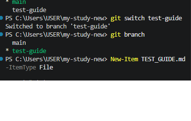

# 📘 2과제 실습 및 검증 가이드

## 1. 실습 목적

본 문서는 과제의 구현 결과뿐만 아니라
실제 실행 과정과 검증 방법을 기록하기 위해 작성하였습니다.

명령어의 의미와 사용 목적을 이해하고,
동일한 작업을 다시 수행할 수 있도록 정리하였습니다.

## 2. 실습 환경

| 항목 | 내용 |
|---|---|
| 운영체제 | Windows |
| 코드 편집기 | VS Code |
| 터미널 | PowerShell |
| 프로그래밍 언어 | Python |
| 버전 관리 | Git |
| 원격 저장소 | GitHub |
| 작업 폴더 | my-study-new |

## 3. Git 저장소 복제

### 저장소 복제 명령어

git clone https://github.com/dana735/my-study-.git my-study-new

### 명령어의 의미

- git : Git 사용
- clone : 원격 저장소 복제
- 저장소 주소 : 복제할 GitHub 저장소
- my-study-new : 새로 생성할 작업 폴더

### 실제 실습 경험

기존 작업 폴더에서 병합 충돌이 발생하였습니다.

기존 작업물을 삭제하거나 강제로 덮어쓰지 않고,
GitHub 저장소를 새로운 폴더에 복제하여
안전하게 작업을 이어갔습니다.

## 4. Git 기본 명령어

| 명령어 | 기능 |
|---|---|
| git status | 파일 변경 상태 확인 |
| git pull | 원격 변경 이력 가져오기 및 통합 |
| git add | 커밋할 변경 사항 선택 |
| git commit | 변경 이력 기록 |
| git push | 원격 저장소로 전송 |
| git branch | 브랜치 목록 확인 |
| git switch | 브랜치 전환 |
| git merge | 브랜치 병합 |

## 5. 브랜치의 개념

브랜치(Branch)는 기존 작업에 영향을 최소화하면서
독립적으로 새로운 기능이나 문서를 작성할 수 있도록
작업 이력을 분리하는 기능입니다.

main 브랜치는 기존 작업을 유지하고,
새로운 브랜치에서는 기능 추가와 테스트를 진행합니다.

검증이 완료되면 main 브랜치에 병합할 수 있습니다.

## 6. 브랜치 생성 및 전환 실습

### 6-1. 현재 브랜치 확인

git branch

별표(*)는 현재 작업 중인 브랜치를 의미합니다.

### 6-2. 새로운 브랜치 생성

git branch test-guide


실습 가이드 작성을 위한 새로운 브랜치를 생성하였습니다.

주의: 브랜치를 생성하는 것만으로는
현재 작업 브랜치가 변경되지 않습니다.

### 6-3. 브랜치 전환

git switch test-guide



새로 생성한 test-guide 브랜치로 이동합니다.

### 6-4. 전환 결과 확인

git branch

별표(*)가 test-guide 옆에 표시되는 것을 확인하였습니다.

### 6-5. 새로운 파일 생성

New-Item TEST_GUIDE.md -ItemType File

PowerShell 명령어를 이용하여
실습 가이드 문서 파일을 생성하였습니다.

## 7. 브랜치 실습 진행 현황

| 실습 항목 | 상태 |
|---|---|
| 현재 브랜치 확인 | 완료 |
| 새로운 브랜치 생성 | 완료 |
| 브랜치 전환 | 완료 |
| 실습 가이드 파일 생성 | 완료 |
| 브랜치 커밋 | 실습 예정 |
| 원격 브랜치 전송 | 실습 예정 |
| main 브랜치 병합 | 실습 예정 |

---## 8. 파이썬 퀴즈 실행 방법

### 8-1. 실행 전 확인 사항

- VS Code에서 my-study-new 폴더를 열었는지 확인합니다.
- quiz2.py 파일이 존재하는지 확인합니다.
- 터미널의 현재 작업 경로를 확인합니다.

### 8-2. 파이썬 설치 및 버전 확인

```powershell
python --version
```

현재 설치된 파이썬의 버전을 확인하는 명령어입니다.

### 8-3. 퀴즈 프로그램 실행

```powershell
python quiz2.py
```

- python : 파이썬 실행 명령어
- quiz2.py : 실행할 프로그램 파일

### 8-4. 프로그램 메뉴 구성

| 번호 | 기능 |
|---|---|
| 1 | 퀴즈 풀기 |
| 2 | 새로운 문제 등록 |
| 3 | 문제 목록 보기 |
| 4 | 최고 점수 확인 |
| 5 | 프로그램 종료 |

## 9. 파이썬 주요 개념

| 개념 | 의미 | 프로그램 적용 |
|---|---|---|
| class | 기능과 데이터를 묶는 설계도 | QuizGame |
| self | 현재 객체 자신 | 객체의 점수 및 데이터 관리 |
| def | 함수 정의 | 기능별 코드 분리 |
| if | 조건 판단 | 정답 및 메뉴 판단 |
| for | 반복 실행 | 퀴즈 문제 출제 |
| while | 조건에 따른 반복 | 메뉴 및 입력값 확인 |
| input | 사용자 입력 | 메뉴 선택 및 정답 입력 |
| print | 화면 출력 | 문제 및 결과 표시 |
| return | 함수 결과 반환 | 데이터 및 입력값 반환 |
| try | 오류가 발생할 수 있는 코드 실행 | JSON 데이터 불러오기 |
| except | 발생한 오류 처리 | 손상 데이터 및 예외 처리 |

### 9-1. 클래스와 객체의 차이

클래스는 프로그램의 설계도이며,
객체는 해당 설계도를 바탕으로 만들어진 실제 실행 대상입니다.

### 9-2. 함수의 사용 목적

프로그램을 기능별로 나누어 작성하면
코드를 이해하고 수정하기 쉬워집니다.

### 9-3. 예외 처리의 필요성

정상적인 입력과 실행뿐만 아니라
잘못된 입력이나 파일 손상 등의 상황도 고려해야 합니다.

예외 처리를 통해 프로그램이 갑자기 종료되거나
기존 데이터가 손실되는 위험을 줄일 수 있습니다.

---## 10. JSON 데이터 구조 및 저장

### 10-1. JSON이란?

JSON은 데이터를 일정한 형식으로 저장하고
다른 프로그램과 교환할 수 있도록 만든 데이터 형식입니다.

파이썬 프로그램이 종료되면 메모리에 있는 데이터는
사라지지만, JSON 파일에 저장하면 다시 사용할 수 있습니다.

### 10-2. state.json의 역할

- 등록된 퀴즈 문제 저장
- 각 문제의 정답 저장
- 최고 점수 저장
- 프로그램 재실행 시 기존 데이터 불러오기

### 10-3. JSON 기본 구조 예시

```json
{
  "quizzes": [
    {
      "question": "대한민국의 수도는?",
      "answer": "서울"
    }
  ],
  "high_score": 3
}
```

| 항목 | 의미 |
|---|---|
| quizzes | 퀴즈 문제 목록 |
| question | 문제 내용 |
| answer | 정답 |
| high_score | 최고 점수 |
| 중괄호 | 객체 표현 |
| 대괄호 | 목록 표현 |

위 코드는 JSON 구조를 이해하기 위한 예시입니다.

### 10-4. 데이터 저장 검증 방법

터미널에서 프로그램을 실행합니다.

```powershell
python quiz2.py
```

1. 메뉴 2번을 선택합니다.
2. 새로운 문제와 정답을 등록합니다.
3. 메뉴 3번에서 등록된 문제를 확인합니다.
4. 메뉴 5번으로 프로그램을 종료합니다.
5. state.json 파일의 저장 내용을 확인합니다.
6. 프로그램을 다시 실행하여 저장된 데이터를 확인합니다.


### 10-5. 최고 점수 저장 검증

1. 메뉴 1번에서 퀴즈를 풉니다.
2. 메뉴 4번에서 최고 점수를 확인합니다.
3. 메뉴 5번으로 프로그램을 종료합니다.
4. python quiz2.py 명령어로 다시 실행합니다.
5. 메뉴 4번에서 이전 최고 점수가 유지되는지 확인합니다.

실제 실습에서 프로그램을 종료하고 다시 실행한 후에도
최고 점수가 유지되는 것을 확인하였습니다.

## 11. 입력값 검증 실습

### 11-1. 입력값 검증의 목적

사용자가 항상 올바른 값을 입력하는 것은 아니므로
잘못된 입력에 대한 처리 기능이 필요합니다.

### 11-2. 주요 입력값 검증 개념

| 개념 | 역할 |
|---|---|
| input() | 사용자 입력 받기 |
| strip() | 입력값 앞뒤 공백 제거 |
| if | 입력 조건 확인 |
| while | 올바른 입력을 받을 때까지 반복 |

### 11-3. 테스트 방법

| 입력값 | 예상 동작 |
|---|---|
| 빈 입력 | 다시 입력하도록 안내 |
| 공백만 입력 | 다시 입력하도록 안내 |
| 9 | 메뉴 선택 범위 오류 안내 |
| abc | 잘못된 메뉴 입력 안내 |
| 1~5 | 해당 메뉴 실행 |

정상 입력뿐만 아니라 잘못된 입력도 확인하여
프로그램의 안정성을 검증할 수 있습니다.

### 11-4. 실제 검증 결과

메뉴 범위를 벗어난 숫자 9를 입력하여
1~5 사이의 번호를 입력하라는 안내를 확인하였습니다.

---

## 12. JSON 오류 유도 및 예외 처리

### 12-1. 실습 목적

정상적인 데이터뿐만 아니라 손상된 데이터가
입력되었을 때 프로그램이 어떻게 대응하는지 확인합니다.

### 12-2. 주요 코드 개념

| 개념 | 역할 |
|---|---|
| json.load() | JSON 파일의 데이터 읽기 |
| json.dump() | 데이터를 JSON 형식으로 저장 |
| try | 오류 발생 가능성이 있는 코드 실행 |
| except | 발생한 오류 처리 |
| ValueError | 잘못된 값이나 형식에 대한 오류 |
| KeyError | 필요한 데이터 항목이 없는 경우 |
| TypeError | 데이터 자료형이 잘못된 경우 |
| OSError | 파일 처리 과정에서 발생하는 오류 |

### 12-3. 스키마 검증이란?

스키마 검증은 데이터가 프로그램에서 요구하는
구조와 형식에 맞는지 확인하는 과정입니다.

- 문제와 정답이 문자열인지 확인
- 문제와 정답이 비어 있지 않은지 확인
- 필요한 데이터 항목이 존재하는지 확인

JSON 문법이 올바르더라도 데이터 구조가
잘못되어 있을 수 있으므로 별도의 검증이 필요합니다.

### 12-4. 오류 테스트 전 주의 사항

- 프로그램을 먼저 종료합니다.
- 실습용 데이터인지 확인합니다.
- 기존 데이터를 반드시 백업합니다.
- 기존 백업 파일이 있다면 덮어쓰지 않습니다.
- quiz2.py 파일은 수정하지 않습니다.

### 12-5. 정상 데이터 백업

PowerShell 터미널에서 실행합니다.

```powershell
Copy-Item state.json state_test_backup.json
```

Copy-Item은 파일을 복사하는 명령어입니다.

기존 state.json을 별도의 파일로 복사하여
정상 데이터를 보존합니다.

### 12-6. 의도적인 JSON 오류 발생

state.json 파일을 열고 실습용으로
기존 내용을 다음 문자열로 변경합니다.

```text
TEST_ERROR
```

Ctrl + S를 눌러 저장합니다.

정상적인 JSON 형식이 아닌 데이터를 만들어
프로그램의 오류 처리 기능을 검증합니다.


### 12-7. 프로그램 재실행

```powershell
python quiz2.py
```

### 12-8. 실제 확인 결과

- 데이터 불러오기 오류 감지
- 손상된 파일 백업
- 기본 데이터 자동 재생성
- 퀴즈 메뉴 정상 실행

실제 오류 상황에서도 프로그램이
손상된 데이터를 처리하는 것을 확인하였습니다.


## 13. 손상 파일 백업 및 데이터 복구

### 13-1. 파일별 역할

| 파일 이름 | 역할 |
|---|---|
| state.json | 현재 사용 중인 데이터 |
| state.json.bak | 손상된 데이터의 자동 백업 |
| state_test_backup.json | 실습 전 정상 데이터의 수동 백업 |

### 13-2. 자동 백업과 재생성

프로그램이 손상된 데이터를 감지하면
기존 파일을 백업하고 기본 데이터를 생성합니다.

기본 데이터가 생성되는 것은 기존 정상 데이터가
자동으로 복원되는 것과는 다릅니다.

### 13-3. 정상 데이터 수동 복구

프로그램을 메뉴 5번으로 종료합니다.

백업 파일에 정상 데이터가 있는지 확인한 후
다음 명령어를 실행합니다.

```powershell
Copy-Item state_test_backup.json state.json -Force
```

- Copy-Item : 파일 복사
- state_test_backup.json : 복원할 정상 데이터
- state.json : 복원 대상 파일
- -Force : 기존 대상 파일을 덮어쓰기

주의: -Force는 기존 파일을 덮어쓸 수 있으므로
복사할 파일과 대상 파일을 반드시 확인합니다.


### 13-4. 복구 결과 확인

```powershell
python quiz2.py
```

메뉴 4번을 선택하여 최고 점수를 확인합니다.

실제 실습에서는 기존 최고 점수 3점이
복원되는 것을 확인하였습니다.


### 13-5. 실습을 통해 배운 점

오류 감지, 예외 처리, 파일 백업,
기본 데이터 재생성 및 정상 데이터 복구는
각각 서로 다른 기능임을 이해하였습니다.

정상적인 프로그램 실행뿐만 아니라
데이터를 안전하게 관리하는 것도 중요합니다.

---
