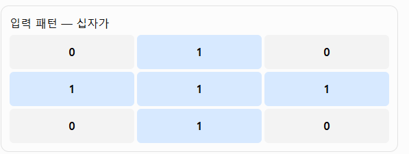
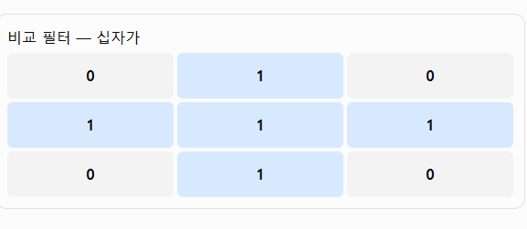
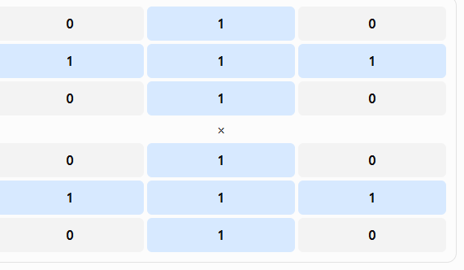
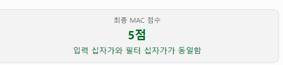
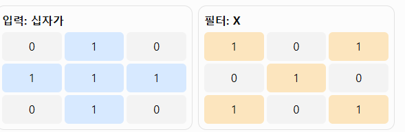
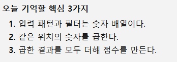
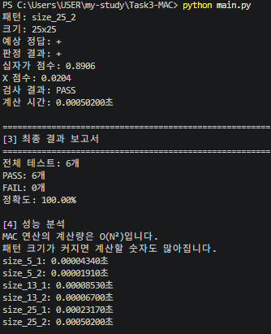
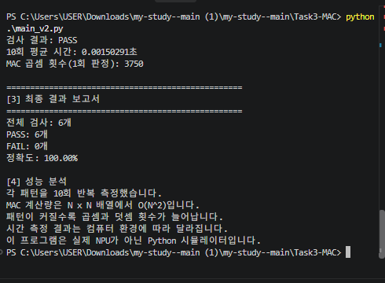

# AI가 계산하는 방식을 흉내 내는 작은 계산기 만들기

## 1. 미션 소개

우리는 그림을 보는 순간 직관적으로 무엇이 ‘십자가’이고 무엇이 ‘X’인지 구별할 수 있습니다. 하지만 컴퓨터는 사람처럼 모양을 시각적으로 인식하지 못합니다.

컴퓨터는 0과 1로 이루어진 숫자 데이터만 이해할 수 있습니다. 따라서 특정 모양을 구별하게 하려면 그림을 숫자 배열로 변환하고, 입력 패턴과 기준 패턴이 얼마나 유사한지 계산해야 합니다.

이 과제에서는 이러한 원리를 간단한 숫자 계산으로 구현해 보며, AI가 패턴을 판단하는 방식을 흉내 내는 작은 계산기를 만들어 봅니다.

## 개발 환경

이번 과제에서는 Python을 사용하여 MAC(Multiply–Accumulate) 연산을 구현하고, 숫자 배열로 표현된 십자가(+)와 X 패턴을 비교하는 프로그램을 작성하였다.

- **프로그래밍 언어:** Python
- **개발 도구:** Visual Studio Code(VS Code)
- **데이터 형식:** JSON (`data.json`)
- **사용 라이브러리:** `json`, `math`, `time`, `pathlib` (Python 표준 라이브러리)
- **실행 방식:** 터미널에서 `python main.py` 실행
- **버전 관리:** GitHub

## CPU와 NPU의 차이

### CPU란?

CPU(Central Processing Unit)는 컴퓨터의 중앙처리장치로, 다양한 종류의 명령을 처리하는 범용 연산 장치이다.

프로그램 실행, 조건 판단, 데이터 처리 등 여러 작업을 수행한다.

### NPU란?

NPU(Neural Processing Unit)는 인공지능 연산을 효율적으로 처리하도록 설계된 전용 연산 장치이다.

AI에서는 수많은 숫자를 곱하고 더하는 계산이 반복되는데, NPU는 이러한 연산을 병렬로 처리하는 데 특화되어 있다.

### CPU와 NPU 비교

| 구분 | CPU | NPU |
|---|---|---|
| 주요 역할 | 다양한 프로그램 실행 | AI 연산 가속 |
| 특징 | 범용적인 작업 처리 | 반복적인 수치 연산에 특화 |
| 연산 방식 | 다양한 명령을 유연하게 처리 | 대량의 곱셈·누적 연산을 병렬 처리 |
| 활용 분야 | 운영체제, 일반 프로그램 | AI 모델의 추론 등 |

### 이번 과제와의 관계

이번 과제에서 구현한 MAC 연산은 AI 계산의 중요한 기본 연산이다.

입력 배열과 필터의 같은 위치에 있는 숫자를 곱하고, 그 결과를 모두 더해 패턴의 유사도를 계산한다.

실제 NPU는 이러한 연산을 대량으로 효율적으로 수행하도록 설계되어 있다.

**이번 프로그램은 실제 NPU 하드웨어를 구현한 것은 아니지만, Python을 통해 NPU에서 활용되는 MAC 연산의 기본 원리를 학습하는 간단한 시뮬레이터이다.**

## 2. 패턴을 숫자로 표현하기
과제 설명에서 보여주는 십자가와 X 모양은 다음과 같이 숫자 배열

십자가 (0 1 0)    X (1 0 1)
      (1 1 1)      (0 1 0)
      (0 1 0)      (1 0 1)

컴퓨터는 모양 자체를 보는 게 아니라, 이런 숫자 배열을 데이터로 받아 처리

그리고 입력된 숫자 배열과 필터(Filter)라는 기준 배열을 비교해서 얼마나 유사한지 점수로 계산해. 이때 같은 위치에 있는 숫끼리 곱하고, 결과를 전부 더하는 방식을 사용

이러한 연산을 MAC(Multiply-Accumulate) 연산

## 3. 과제 목표

- MAC(Multiply-Accumulate) 연산이 무엇이고 AI에서 왜 중요한지 설명할 수 있다.
- 입력 패턴과 필터를 곱하고 더해서 유사도(점수)를 계산하는 원리를 설명할 수 있다.
- data.json의 규칙(라벨 규칙)을 해석하고, 프로그램 내부에서 라벨을 표준화(정규화)하는 이유를 설명할 수 있다.
- 부동소수점 오차가 판정에 어떤 영향을 주는지, 그리고 허용 오차 기반 비교 정책이 필요한 이유를 설명할 수 있다.
- 크기 변경 연산 시 공간을 압축하고, 패턴 크기 증가에 따른 시간 복잡도 \(O(N^2)\)를 근거와 함께 설명할 수 있다.
- 실패 케이스가 발생했을 때 원인을 데이터/스키마 문제, 로직 문제, 수치 비교 문제로 구분해 진단하고 개선할 수 있다.

## 1. 미션 소개
## 2. 패턴을 숫자로 표현하기
## 3. 과제 목표
## 4. 과제 요구사항
## 5. 구현 과정
## 6. 실행 방법
## 7. 테스트 결과
## 8. 실패 케이스 및 개선

 – MAC 연산을 이용한 패턴 분석

## 1. 과제 목표

이번 과제에서는 MAC 연산(Multiply–Accumulate)을 이용하여 숫자 배열로 표현된 패턴을 비교하고, 패턴의 종류를 판별하는 프로그램을 구현한다.

또한 제공된 JSON 데이터를 이용하여 패턴을 분석하고, 배열 크기에 따른 연산 시간과 프로그램의 결과를 확인한다.

## 2. MAC 연산 개념

MAC은 Multiply–Accumulate의 약자로, 두 배열의 같은 위치에 있는 숫자를 곱한 후 그 결과를 모두 더하는 연산이다.

- Multiply(곱셈): 같은 위치의 숫자끼리 곱한다.
- Accumulate(누적): 곱한 결과를 모두 더한다.

이 연산을 이용하면 입력 패턴과 기준 필터가 얼마나 일치하는지 점수로 확인할 수 있다.

input_pattern = [
    0, 1, 0,
    1, 1, 1,
    0, 1, 0
]

- 필터(Filter)는 비교

filter_pattern = [
    0, 1, 0,
    1, 1, 1,
    0, 1, 0
]

- 같은 위치끼리 곱하기 (Multiply)

은 1과 1이 만나는 곳은 1이 되고, 0이 하나라도 있으면 곱한 결과는 0이 된다
결과를 모두 더하기 (Accumulate)
이제 곱셈 결과를 전부 더해 보자.
\[
0+1+0+1+1+1+0+1+0
\]

\[
=5
\]

-  MAC 연산

같은 위치끼리 곱하고 → 그 결과를 전부 더한다

입력       X 필터     곱셈 결과

0 1 0      1 0 1       0 0 0
1 1 1  ×   0 1 0   =   0 1 0
0 1 0      1 0 1       0 0 0

\[
0+0+0+0+1+0+0+0+0=\boxed{1}
\]

- 십자가 필터와 비교했을 때: 5점
- X 필터와 비교했을 때: 1점

원리

컴퓨터는 사람처럼 그림의 모양을 직접 이해하지 못하므로, 그림을 숫자 배열로 변환하여 처리한다.

변환된 입력 패턴을 Cross 필터와 X 필터에 각각 적용하고, MAC 연산 결과를 비교하여 패턴을 판별한다.

- Cross 점수가 더 높은 경우: Cross 판정
- X 점수가 더 높은 경우: X 판정  *(X필터 추가 필터 2개)
- 두 점수가 동일한 경우: UNDECIDED(판정 불가)
- 0  0  0
0  1  0
0  0  0

## 4. 프로그램 기능

### 1) 사용자 입력
3×3 크기의 패턴 A와 B를 입력하고, MAC 점수와 판정 결과를 확인한다.

### 2) JSON 데이터 분석
과제에서 제공된 `data.json` 파일의 필터와 패턴 데이터를 불러와 분석하고, 판정 결과를 출력한다.

### 3) 성능 분석
배열 크기별 MAC 연산 시간을 측정하고, 평균 연산 시간(ms)과 연산 횟수를 확인한다.

### 4) 결과 리포트
전체 테스트 결과, 성공 및 실패 건수, 실패한 테스트 목록과 원인을 정리한다.

## 5. 실행 방법

1. `main.py`와 `data.json` 파일을 같은 프로젝트 폴더에 둔다.
2. 터미널에서 프로젝트 폴더로 이동한다.
3. 아래 명령어를 실행한다.

    python main.py

4. 실행 메뉴에서 원하는 기능을 선택한다.

## 6. 실행 결과 및 분석

프로그램 실행 후 제공된 JSON 데이터의 패턴을 분석하고, 각 패턴의 MAC 점수와 판정 결과를 확인한다.

판정 결과가 정답과 일치하는 경우와 구분하지 못하는 경우를 확인하여 MAC 연산을 이용한 패턴 판별의 가능성과 한계를 분석한다.

성능 분석에서는 배열 크기가 증가할 때 연산 시간에 어떤 변화가 발생하는지 확인한다.

※ 실제 실행 결과와 PASS/FAIL 수치는 프로그램 실행 후 확인한 결과를 기록한다.

## 7. 결론

이번 과제를 통해 숫자 배열을 이용한 패턴 비교 방법과 MAC 연산의 원리를 이해할 수 있었다.

또한 필터별 점수를 비교하여 패턴을 판별하는 과정과, 데이터에 따라 판정이 어려운 경우가 발생할 수 있다는 점을 확인하였다.

성능 측정을 통해 배열의 크기와 연산량이 실행 시간에 미치는 영향도 분석할 수 있었다.

## 8. 개선 버전(main_v2.py) 실행 결과

기존 main.py는 그대로 유지하고, 개선 버전인 main_v2.py를 추가하여 실행했습니다.

### 실행 결과 보고서

### 개선 버전을 추가한 이유

처음 작성한 `main.py`에서 MAC 연산을 이용한 십자가(Cross)와 X 패턴 판별 및 JSON 데이터 분석 기능을 구현했습니다.

이후 과제의 세부 요구사항을 다시 확인하면서 결과 판정의 정확성과 데이터 검증, 성능 측정 방법을 보완하기 위해 `main_v2.py`를 별도로 작성했습니다.

기존 프로그램의 작업 과정과 결과를 보존하고, 개선 전후의 차이를 비교할 수 있도록 두 파일을 모두 유지했습니다.

### 주요 개선 사항

| 개선 항목 | 개선 내용 |
|---|---|
| 라벨 정규화 | `+`, `cross`, `x` 등의 표현을 표준 라벨로 통일 |
| 동점 처리 | 두 점수 차이가 허용오차보다 작으면 `UNDECIDED`로 판정 |
| 입력값 검증 | 배열의 크기, 형태, 숫자 데이터의 유효성 확인 |
| 성능 측정 | 각 패턴을 10회 반복 측정하여 평균 시간 계산 |
| 연산량 분석 | 패턴 크기에 따른 MAC 곱셈 횟수 출력 |
| 오류 처리 | 잘못된 JSON 데이터나 필터에 대한 오류 메시지 출력 |

### 주요 개선 기능에 대한 설명

**1. 라벨 정규화**

같은 패턴이라도 `+`, `cross`, `Cross`처럼 이름이 다르게 표현될 수 있습니다. 이러한 표현을 하나의 이름인 `Cross`로 통일하고, `x`, `X`도 `X`로 통일하여 비교할 때 혼동이 없도록 했습니다.

**2. 동점 처리 (epsilon)**

MAC 연산으로 계산한 Cross와 X의 점수가 거의 같으면 어느 쪽이 더 비슷한지 확실하게 판단하기 어렵습니다.

따라서 두 점수의 차이가 매우 작은 경우에는 억지로 한쪽을 선택하지 않고 `UNDECIDED(판정 보류)`로 처리하도록 개선했습니다.

**3. 입력값 검증**

프로그램에 입력되는 숫자나 배열의 크기, 형태가 올바른지 확인하는 기능입니다.

예를 들어 3×3 배열에 숫자가 부족하거나 잘못된 값이 들어오면 그대로 계산하지 않고 오류를 확인하도록 했습니다.

**4. 성능 측정 개선**

한 번만 시간을 측정하면 컴퓨터 상태에 따라 결과가 달라질 수 있습니다. 그래서 10회 반복 측정한 평균값을 사용해 결과를 조금 더 안정적으로 비교하도록 했습니다.

또한 배열의 크기가 N×N일 때 MAC 연산 횟수는 N²에 비례하므로, 배열이 커질수록 계산량도 증가한다는 점을 확인할 수 있습니다.

### 개선 버전 실행 결과

`main_v2.py`를 실행하여 제공된 데이터의 6개 패턴을 검사한 결과, 모두 정상적으로 판정되었습니다.

- 전체 검사: 6개
- PASS: 6개
- FAIL: 0개
- 정확도: 100%

이번 결과는 제공된 6개 테스트를 모두 통과했다는 의미입니다. 기존 프로그램을 보존하면서 세부 기능을 개선하는 과정을 경험할 수 있었습니다.

